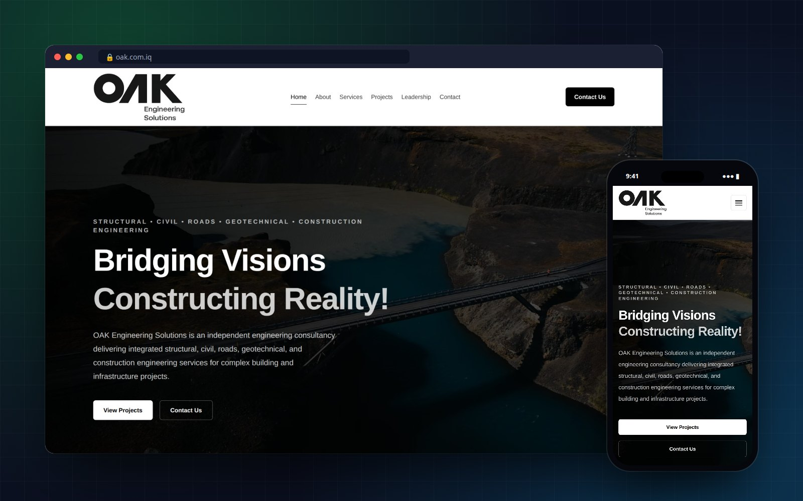
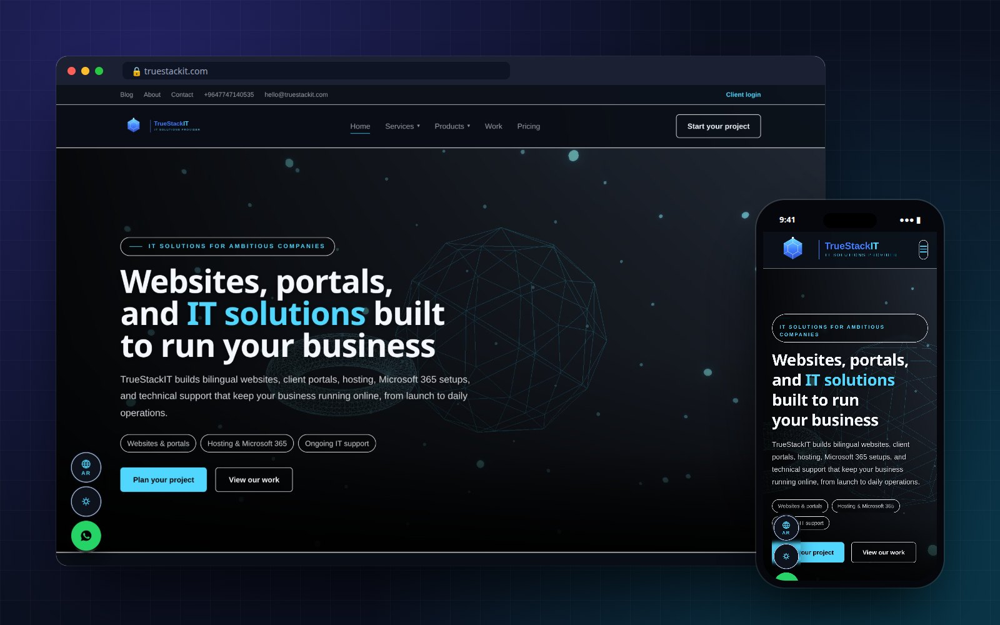
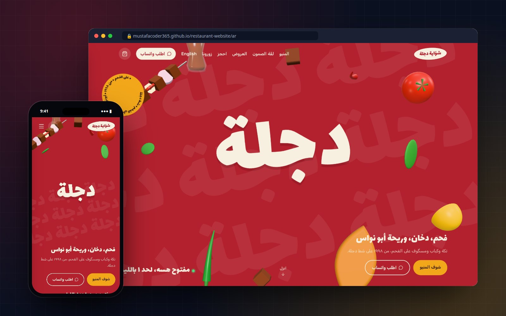
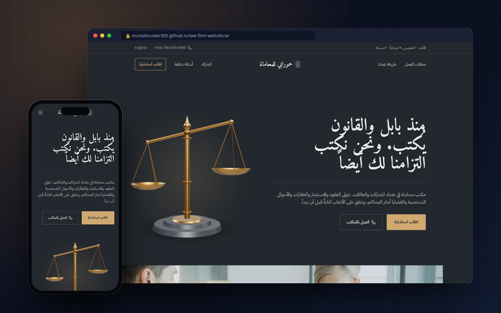
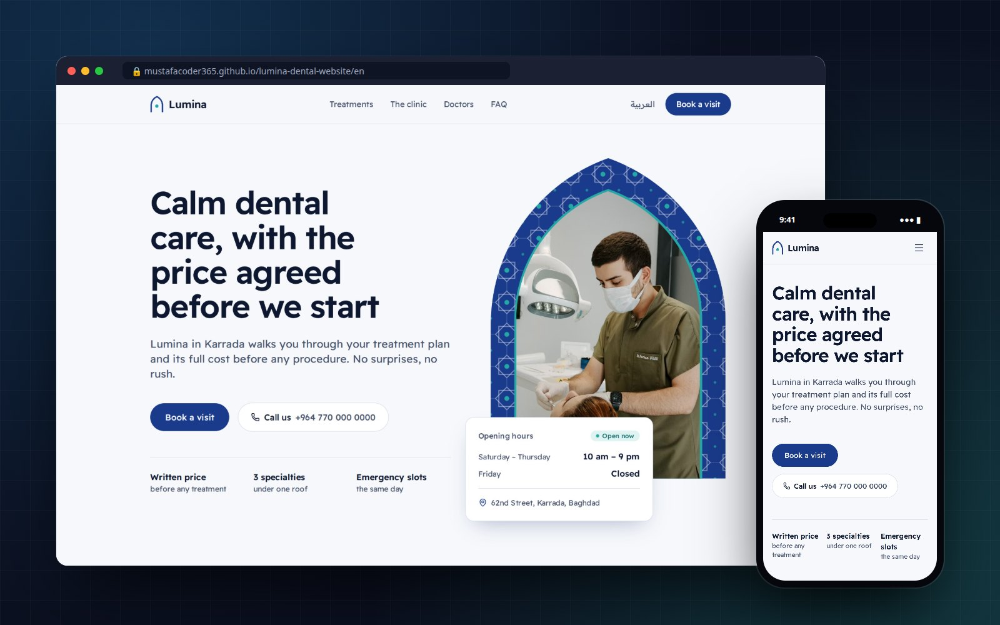
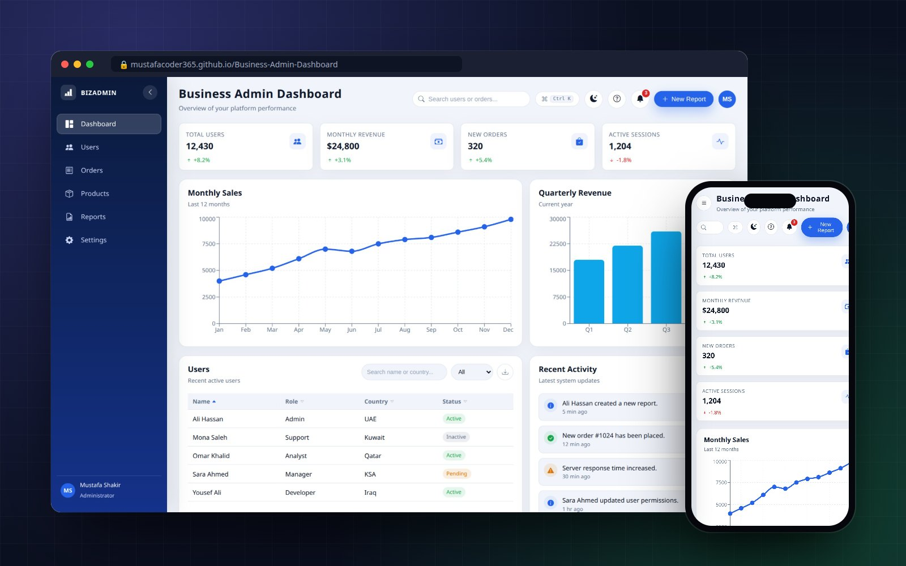
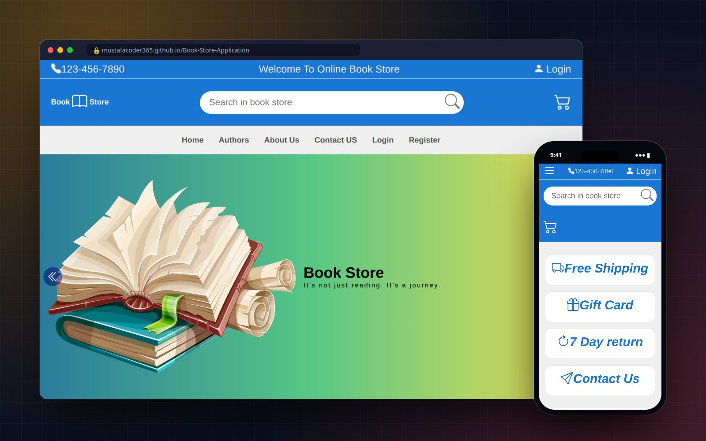
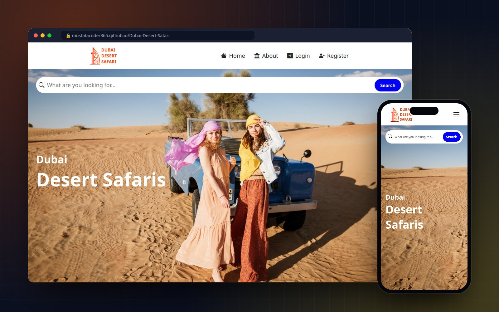

  
  
  
  

## 👋 About me

I'm a frontend developer from Baghdad who builds **fast, polished websites and web apps** with Next.js, React, and TypeScript, from company sites to admin dashboards and full-stack platforms.

- 🌍 **Arabic and English, done properly**: real right-to-left layouts, not mirrored afterthoughts
- 🧊 **Interactive 3D on the web** with Three.js and React Three Fiber, tuned to stay smooth on ordinary laptops and phones
- 🎨 **Distinct design for every brand**: each site below has its own identity, layout, and typography
- ⚡ **Production habits**: accessibility, performance, SEO, CI/CD, and clean, reusable components

 

## 💼 Client work

### OAK Engineering Solutions — Corporate website

Official website for an Iraqi engineering consultancy, delivered from requirements to production.

- Built with **Next.js, TypeScript, and Tailwind CSS**
- Mobile-first, fully responsive UI with a reusable component architecture

 

## 🚀 Featured projects

### 🧱 TrueStackIT — Full-stack IT services platform

Bilingual platform for an IT services company: public marketing site, admin dashboard, and client portal.

- **Auth, RBAC, and audit logging**, with rate limiting and CSRF / CSP / HSTS hardening
- **Payments** with PayTabs and ZainCash, plus a full CMS with admin CRUD
- Custom **Three.js** 3D hero, Dockerized **CI/CD**

`Next.js 15` `TypeScript` `NestJS` `PostgreSQL` `Prisma` `Three.js` `Docker` `Jest`

---

### 🍢 Dijla Grill — Restaurant website with 3D food and online ordering

A playful Baghdadi charcoal-grill concept. Food modeled in code floats around the title, and a scroll scene builds a samoon sandwich layer by layer.

- **Online ordering**: photo menu with Arabic-aware search and filters, an order panel, and checkout straight to WhatsApp
- **Table booking**, group deals, live "open now" status in Baghdad time
- **Real-time 3D** that only renders while visible, with lighter scenes on phones

`Next.js 16` `Three.js` `React Three Fiber` `TypeScript` `Tailwind CSS 4`

---

### ⚖️ Hammurabi Law — Law firm website with a 3D scale of justice

A Baghdad law firm concept with an identity drawn from the Code of Hammurabi stele.

- **Interactive bronze scale** in 3D that tips as you scroll and weighs the case in a pinned scene
- **Fee estimator**, practice-area pages, partners, FAQ, and a validated consultation form
- Classic Arabic / Latin typography, automatic language detection

`Next.js 16` `Three.js` `React Three Fiber` `TypeScript` `Tailwind CSS 4`

---

### 🦷 Lumina Dental — Dental clinic website

A dental clinic concept whose visual identity comes from Baghdad's kashi tilework.

- Treatments with transparent starting prices in IQD
- Live "open now" status and a validated booking form for Iraqi phone numbers
- Accessible, mobile-first, static export deployed with GitHub Actions

`Next.js 16` `TypeScript` `Tailwind CSS 4` `React 19`

 

## 🧩 More apps

<table>
  <tr>
    <td width="33%" valign="top">
      
      <h4>📊 Business Admin Dashboard</h4>
      Six-page analytics dashboard: live charts, sortable tables with CSV export, a <b>Ctrl+K</b> command palette, and dark mode.
        
      <code>React 19</code> <code>Recharts</code> <code>Framer Motion</code>
        
      <a href="https://mustafacoder365.github.io/Business-Admin-Dashboard/">Live</a> · <a href="https://github.com/MustafaCoder365/Business-Admin-Dashboard">Code</a>
    </td>
    <td width="33%" valign="top">
      
      <h4>📚 Book Store</h4>
      E-commerce store with live search, a persistent cart, multi-step checkout, and login / register flows.
        
      <code>React</code> <code>Context API</code> <code>Vite</code>
        
      <a href="https://mustafacoder365.github.io/Book-Store-Application/">Live</a> · <a href="https://github.com/MustafaCoder365/Book-Store-Application">Code</a>
    </td>
    <td width="33%" valign="top">
      
      <h4>🏜️ Dubai Desert Safari</h4>
      Tour booking app with listings, detail pages, ratings and reviews, and a pricing card.
        
      <code>React</code> <code>React Router</code> <code>Toastify</code>
        
      <a href="https://mustafacoder365.github.io/Dubai-Desert-Safari/">Live</a> · <a href="https://github.com/MustafaCoder365/Dubai-Desert-Safari">Code</a>
    </td>
  </tr>
</table>

<b>🧪 UI practice and smaller projects</b>

 

| Project | Repository |
|---|---|
| YouTube Clone | [YouTube-Clone](https://github.com/MustafaCoder365/YouTube-Clone) |
| Kasper Template | [kasper-template](https://github.com/MustafaCoder365/kasper-template) |
| Leon Template | [leon-template](https://github.com/MustafaCoder365/leon-template) |
| Mood Login UI | [mood-login-ui](https://github.com/MustafaCoder365/mood-login-ui) |
| Mood Soft Slider | [mood-soft-slider](https://github.com/MustafaCoder365/mood-soft-slider) |
| Rock Paper Scissors | [Rock-Paper-Scissors](https://github.com/MustafaCoder365/Rock-Paper-Scissors) |

 

## 🛠️ Tech stack

| Area | Tools |
|---|---|
| **Frontend** |  |
| **3D & motion** |  &nbsp; React Three Fiber · Framer Motion |
| **Backend** |  |
| **Databases** |  |
| **Tools** |  |

 

## 📊 GitHub stats

  <picture>
    <source media="(prefers-color-scheme: dark)" srcset="./profile/stats-dark.svg" />
    
  </picture>
  <picture>
    <source media="(prefers-color-scheme: dark)" srcset="./profile/top-langs-dark.svg" />
    
  </picture>

 

### 🤝 Let's build something together

Need a website, a dashboard, or a web app for your business? I'm open to full-time roles, remote work, and freelance projects.

