# Hi 👋, I'm Mustafa Shakir

### Frontend Software Developer — Next.js · React · TypeScript

I build fast, modern, production-ready web apps — from company websites to admin dashboards and full-stack platforms.

📍 Baghdad, Iraq &nbsp;•&nbsp; 💼 Open to Full-Time & Remote Opportunities

---

## 💼 Experience

**Frontend Software Developer — [OAK Engineering Solutions](https://oak.com.iq)**

Delivered the official corporate website for an Iraqi engineering consultancy, from requirements to production.

- Built with **Next.js, TypeScript, and Tailwind CSS**
- Mobile-first, fully responsive UI
- Reusable component architecture

🌐 **Live:** [oak.com.iq](https://oak.com.iq)

---

## 🚀 Featured Projects

### 🧱 TrueStackIT — Full-Stack IT Services Platform

Bilingual (Arabic / English) platform for an IT services company: public marketing site, admin dashboard, and client portal.

- Authentication, **RBAC**, and audit logging
- Security hardening: rate limiting, CSRF / CSP / HSTS
- Payment gateways: **PayTabs, ZainCash**
- Full CMS with admin CRUD
- Custom **Three.js** 3D hero experience
- CI/CD with Docker

`Next.js 15` `TypeScript` `Tailwind CSS` `NestJS` `PostgreSQL` `Prisma` `Three.js` `Docker` `Jest`

---

### 🦷 Lumina Dental — Clinic Website (Concept)

Bilingual (Arabic / English) website for a fictional dental clinic in Baghdad, with a visual identity drawn from Baghdad's kashi tilework.

- Full Arabic and English with right-to-left layout and automatic language detection
- Live "open now" status calculated in Baghdad time
- Treatments with transparent starting prices in IQD
- Validated booking form for Iraqi phone numbers
- Accessible, mobile-first, deployed as a static site with GitHub Actions

`Next.js 16` `TypeScript` `Tailwind CSS 4` `React 19`

---

### ⚖️ Hammurabi Law — Law Firm Website (Concept)

Bilingual (Arabic / English) website for a fictional Baghdad law firm, with an identity drawn from the Code of Hammurabi stele.

- Hero stele with a real photo as its relief and the firm's promises "carved" over cuneiform texture
- Full Arabic and English with right-to-left layout and automatic language detection
- Practice areas, partners, office, FAQ, and a validated consultation form
- Classic Arabic/Latin typography (Amiri + IBM Plex Sans Arabic), deployed with GitHub Actions

`Next.js 16` `TypeScript` `Tailwind CSS 4` `React 19`

---

### 🍢 Dijla Grill — Restaurant Website (Concept)

Playful, bilingual (Arabic / English) website for a fictional Baghdadi charcoal grill, with real-time 3D food built in Three.js.

- 3D food (skewer, tomato, samoon, tea glass…) floating around a giant title, reacting to pointer and scroll
- Pinned scroll scene that builds a 3D samoon sandwich layer by layer
- Full tabbed menu with IQD prices, live "open now" status in Baghdad time, tilted marquee ribbons
- Opening animation, RTL layout, and fast on-demand 3D rendering

`Next.js 16` `Three.js` `React Three Fiber` `TypeScript` `Tailwind CSS 4`

---

### 📊 Business Admin Dashboard

Enterprise-style analytics dashboard with six fully functional pages: Dashboard, Users, Orders, Products, Reports, and Settings.

- Live sales & revenue charts
- Sortable, paginated tables with **CSV export** and bulk actions
- Global **command palette** (Ctrl / Cmd + K) and keyboard-navigable search
- Detail drawers, notifications center, dark / light theme
- Reusable component and CSS-variable design system

`React 19` `Vite` `React Router` `Recharts` `Framer Motion` `Context API`

---

### 📚 Book Store Application

Full-featured e-commerce book store.

- Product catalog with live search
- Shopping cart (Context API + localStorage)
- Multi-step checkout flow
- Login / register with modal and full-page views

`React` `React Router` `Context API` `Vite` `CSS3`

---

### 🏜️ Dubai Desert Safari

Tourism booking web app.

- Tour listings and dynamic tour detail pages
- Ratings, reviews, and a booking / pricing card
- Login / register with validation and toast notifications
- Fully responsive layout

`React` `React Router` `Vite` `React Toastify` `CSS3`

---

<b>🧪 More projects & UI practice</b>

 

| Project | Repository |
|---|---|
| YouTube Clone | [YouTube-Clone](https://github.com/MustafaCoder365/YouTube-Clone) |
| Kasper Template | [kasper-template](https://github.com/MustafaCoder365/kasper-template) |
| Leon Template | [leon-template](https://github.com/MustafaCoder365/leon-template) |
| Mood Login UI | [mood-login-ui](https://github.com/MustafaCoder365/mood-login-ui) |
| Mood Soft Slider | [mood-soft-slider](https://github.com/MustafaCoder365/mood-soft-slider) |
| Rock Paper Scissors | [Rock-Paper-Scissors](https://github.com/MustafaCoder365/Rock-Paper-Scissors) |

---

## 🛠️ Tech Stack

| Area | Tools |
|---|---|
| **Frontend** |  |
| **Backend** |  |
| **Databases** |  |
| **Tools** |  |

---

## 📊 GitHub Stats

  <picture>
    <source media="(prefers-color-scheme: dark)" srcset="./profile/stats-dark.svg" />
    
  </picture>
  <picture>
    <source media="(prefers-color-scheme: dark)" srcset="./profile/top-langs-dark.svg" />
    
  </picture>

---

**Let's build something great together.**

📧 [mustafa1997670@gmail.com](mailto:mustafa1997670@gmail.com) &nbsp;•&nbsp; 🔗 [LinkedIn](https://www.linkedin.com/in/mustafa-shakir-840374330)

⭐ Always building. Always improving.

